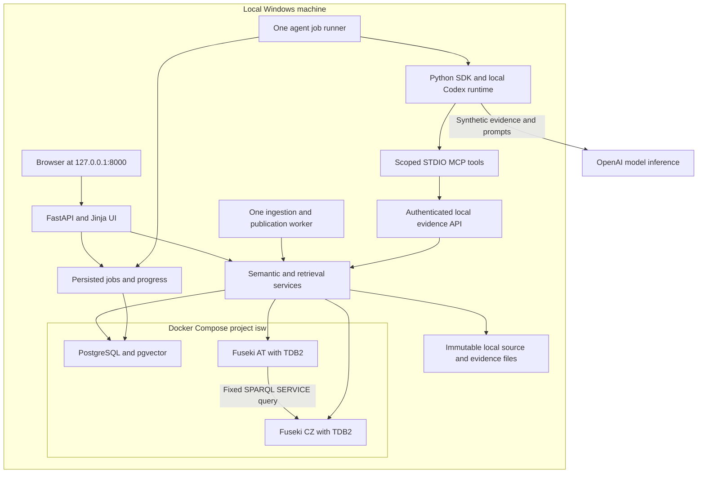

# Insurance Semantic Workbench implementation plan

> Historical build baseline. The implemented application, runtime adjustments, and measured acceptance results are documented in [implementation status](docs/IMPLEMENTATION_STATUS.md) and [verification](docs/verification.md). Future-tense sections below describe the original contract, not outstanding work.

Plan baseline: 12 October 2026. Build an independent, local knowledge platform for reviewing fictional household water-damage claims in Austria and Czechia. Preserve the original scope: ontology architecture, country extensions, vocabulary governance, source integration, provenance, validation, federation, three retrieval modes, a Codex evidence assistant, and semantic release management.

The central question is: **For this claim, which policy version and clauses applied at the time of loss, what do the sources establish, what is missing or contradictory, and what should the handler review next?**

The implementation decisions below are the build baseline. Runtime checks in Phase 0 establish that the installed stack actually works together; documentation research and dependency resolution cannot replace those checks. No application implementation, infrastructure installation, or repository publication has been performed as part of this planning step.

## 1 Project constraints and completion criteria

### Standing constraints

- Run the application, databases, embeddings, semantic processing, and agent tools locally. Bind host services to loopback. There is no cloud deployment.
- Codex model inference uses OpenAI through the owner's ChatGPT sign-in. The application is locally deployed, not fully offline. Synthetic evidence sent to Codex crosses that boundary.
- Create the public GitHub repository `fullstack-nick/insurance-semantic-workbench` during implementation. Use MIT with `Copyright (c) 2026 Nick Petrushin`. These publication details are confirmed by the owner.
- Use independent project branding. All insurers, products, contracts, people, claims, and operating rules in fixtures are invented. Do not name real insurers or their products, imply affiliation, or retain references to an employer, recruitment posting, or company-specific origin in project material.
- No CI/CD, hosted demo, GitHub Actions workflows, cloud database, or paid API-key fallback.
- No unit tests. Use a compact suite of E2E workflows against real local services. Add a small integration check only when an important live boundary cannot be adequately observed through E2E coverage; seven is a ceiling, not a target.
- Keep one modular Python codebase and a server-rendered UI. No SPA, Node build pipeline, broker, Kubernetes, general-purpose autonomous agent, or separate vector database.
- The assistant supplies evidence and proposed next steps. A human records review decisions through explicit application actions.

### Finished workflows

| Workflow | Observable finished behavior |
|---|---|
| Claim evidence review | Select a case; find its historical policy version and purchased coverages; inspect clauses and source records; see uncertainty; generate and inspect a cited review brief; record a human review disposition |
| Semantic stewardship | Browse concepts and multilingual labels; inspect source mappings and ownership; review validation failures; resolve mapping proposals without inventing evidence; propose a scoped country extension |
| Architecture and lifecycle | Compare releases; inspect affected consumers, mappings, shapes, and retrieval results; validate and approve a candidate; activate a coherent snapshot; restore the preceding snapshot; compare retrieval modes |

Completion requires the whole demonstration in section 15, successful local checks, a tested restore, and a portfolio-ready public repository. A running CRUD application or an uncited chat panel is not sufficient.

### Dataset and semantic scope

| Area | Initial vertical slice | Final demonstration |
|---|---|---|
| Country operations | Austria | Austria and Czechia |
| Policies | 10 | 100: 60 AT, 40 CZ; include at least 20 historical policy versions in addition to current versions |
| Claims | 10 | 50: 30 AT, 20 CZ |
| Documents | 6 immutable document versions | 32 immutable versions: 18 AT, 14 CZ, including superseded versions |
| Ontology | Minimum concepts needed by the slice | Approximately 25–35 application classes and 40–60 properties |
| SKOS vocabulary | Initial perils, roles, states, document types | Approximately 40 concepts with English, German, and Czech labels where relevant |
| Validation | Initial structural and readiness profiles | Approximately 20 meaningful shapes |
| Competency questions | Historical policy and evidence tracing first | 18 fixed SPARQL queries |
| Retrieval evaluation | A few authored examples | 28 labeled questions, with 20 development cases and 8 held out |

Use English for the UI, README, architecture material, and default briefs. Use English/German/Czech terminology and German/Czech source passages to demonstrate multilingual semantics. Full UI translation is outside scope. Country labels describe fictional operating profiles, not actual national insurance law.

## 2 Technology and local topology

### Selected stack

| Responsibility | Baseline | Implementation rule |
|---|---|---|
| Python | 3.12, explicitly selected | Use the installed 3.12.10 initially; `python` currently points to 3.11 |
| Environment | uv, `pyproject.toml`, `uv.lock` | Pin the successful Phase 0 set and use `uv sync --frozen` thereafter |
| Web application | FastAPI, Pydantic, Jinja2, Uvicorn | HTML forms, small local JavaScript modules, SSE for long-running progress |
| Operational storage | PostgreSQL 17 with pgvector 0.8.7 | One instance, separate source/workbench schemas; SQLAlchemy, Alembic, psycopg binary wheels |
| RDF store | Apache Jena Fuseki 6.2.0 with TDB2 | Two independently stoppable country services using one shared image |
| Semantic processing | RDFLib and pySHACL | Explicit local ontology composition and materialized RDFS inference |
| Embeddings | Sentence Transformers, CPU PyTorch, `intfloat/multilingual-e5-small` | 384 dimensions; cosine similarity; exact vector search |
| Agent adapter | Official Python `openai-codex` SDK | Stable paired SDK/runtime, local app-server, same user's Codex-managed sign-in |
| Agent tools | Official Python MCP package | Six scoped, read-only evidence tools over STDIO |
| Ontology inspection | Turtle in Git and Protégé Desktop | Protégé is an authoring aid, not an application dependency |
| Verification | pytest and Playwright Python | Chromium E2E, optional justified live integration checks, local Ruff checks |

The package candidates have passed a Windows/Python 3.12 resolver check with binary wheels only. See [local environment and storage](docs/LOCAL_ENVIRONMENT.md) and the [resolved dependency research](docs/research/dependencies-windows-py312.txt). Installation and execution remain Phase 0 work.

Use the pgvector project's published `0.8.7-pg17-bookworm` image, pin its Linux amd64 digest when composing the stack, and record the observed PostgreSQL patch version after startup. The inspected amd64 digest is `sha256:cd4ccfdaf62cbfeb5c6ee19ef0dd663406d4ed740c320b324d016a90e85385b3`. [pgvector installation](https://github.com/pgvector/pgvector#docker)

Build a small Fuseki image from the official 6.2.0 distribution with its published SHA512 verification and a pinned Java 21 runtime image. Jena 6 requires Java 21. Record archive checksums and the base-image digest in the build inputs. Apache provides Docker build guidance; do not assume that an arbitrary Docker Hub image is an Apache-maintained distribution. [Jena releases](https://jena.apache.org/download/), [Fuseki Docker tools](https://jena.apache.org/documentation/fuseki2/fuseki-docker.html)

### Processes and networking



| Service | Host binding | Container address or storage |
|---|---|---|
| Web and internal evidence API | `127.0.0.1:8000` | Windows-native process |
| PostgreSQL | `127.0.0.1:54320` | `postgres:5432`; project named volume |
| Fuseki AT | `127.0.0.1:3030` | `fuseki-at:3030`; separate TDB2 volume |
| Fuseki CZ | `127.0.0.1:3031` | `fuseki-cz:3030`; separate TDB2 volume |
| Codex and MCP | STDIO | Child processes; no public MCP listener |

Container-to-container federation uses Compose DNS, not a host loopback URL. Exposing a port without an explicit loopback host address can expose it beyond the machine. [Docker port publishing](https://docs.docker.com/engine/network/port-publishing/)

Keep embeddings and application code native to avoid a second Python image and to reuse Windows Codex authentication. Store database files in named Linux volumes rather than NTFS bind mounts. Use `.runtime/` for project-owned logs, immutable documents, downloads, and run artifacts; exclude it from Git. Keep frontend assets local and fetch no CDN scripts or fonts at runtime.

### Internal modules and ownership

```text
src/insurance_workbench/
  config/             typed settings, paths, process configuration
  db/                 SQLAlchemy models, repositories, transactions
  sources/            policy tables, claims API, snapshots, documents, outbox
  semantic/           identifiers, mappings, inference, validation, graph publication
  retrieval/          chunking, fact cards, vectors, graph templates, evidence bundles
  governance/         proposals, dependencies, candidate releases, activation, rollback
  agents/             CodexGateway, run lifecycle, response validation, scoped MCP
  web/                routes, templates, local CSS and JavaScript
  worker/             ingestion and agent-job entry points
  cli/                seed, replay, evaluate, backup, restore, inspect
ontology/             enterprise, domain, country, use-case, vocabulary, local catalog
shapes/               structural and review-readiness profiles
mappings/             versioned source mapping specifications
queries/              fixed SPARQL queries and consumer manifests
fixtures/             invented input records, documents, expected outcomes
releases/             immutable semantic release manifests
tests/e2e/            real-service workflows
tests/integration/    only justified checks that E2E cannot adequately observe
scripts/              PowerShell lifecycle entry points
docs/                 architecture, decisions, runbook, evaluation, screenshots
```

Use dependency injection at service boundaries without creating a generic plugin framework. Source adapters call the same publication services as replay. Web routes and MCP tools call the same scoped retrieval services. PostgreSQL stores job state; polling plus SSE avoids a Redis or task-broker dependency.

## 3 Business and temporal contract

### Meaning and identity

- A `Policy` is a contract; a `PolicyVersion` records a period of contract terms. A document is a representation, not the policy itself.
- A product offers coverage definitions; a policy version records purchased coverage. An offered coverage does not imply it was purchased.
- A claim is distinct from the loss event. Multiple claims can refer to one event.
- A party is distinct from a contextual role assignment such as policyholder, claimant, or assessor.
- A business entity is distinct from each source record describing it. Match records with an explicit source-ID crosswalk; name similarity creates a review proposal only.
- Separate operating country, property country, product context, and document language. A German label never selects a validation profile by itself.
- A source assertion is not an established business fact merely because a document states it. Preserve competing assertions and their evidence.

Use `https://example.org/isw/` as the fictional base IRI. Terms have stable unversioned identifiers such as `.../ontology/insurance#Policy`; release metadata supplies ontology version IRIs. Entities use namespaced source identifiers, for example `.../id/at/policy/P001`. Versioned records, document versions, clauses, assertions, bundles, and projections have distinct IRIs/IDs. Never put customer names in identifiers. Use deterministic IDs for seeded records and SHA256 for content-addressed immutable files.

### Effective time and recorded time

Use date-only `valid_from` and exclusive `valid_to` for fixture contract periods. A policy version applies when `valid_from <= loss_date < valid_to`; an absent upper bound means open-ended. Record a separate UTC `recorded_at`/`ingested_at` timestamp. Monetary values are decimals plus currency, never floats.

Require one unambiguous applicable version for the selected policy and loss date. Zero matches means missing historical context; two matches means invalid overlapping versions. Do not choose the newest version as a fallback. A later-arriving endorsement may have an earlier effective date: its effect belongs to the new source snapshot, while the previous evidence bundle remains reproducible.

Retrieve clauses through the applicable policy version and its purchased coverage. A superseded document may still be correct evidence for an older loss. A document arriving after the loss can be an assessor report about that loss; distinguish observation/report dates from contractual applicability. Do not filter all document kinds through one effective-date rule.

### Source representations

| Source | Authoritative data in this project | Mutation and version rule |
|---|---|---|
| Policy administration | SQL policy/version/coverage/party-role rows | Source transaction writes a new version and its outbox event together |
| Claims simulation | Pydantic-validated JSON HTTP API backed by source tables | Events carry full aggregate snapshots, not deltas |
| Document repository | UTF-8 text/Markdown files with structured version and clause metadata | Replacements create new immutable versions; original bytes remain available |

Keep document parsing deterministic in v1: authored clauses and passages with exact text offsets. Arbitrary PDF/OCR extraction, automatic interpretation of real contracts, and external datasets are outside scope. A future export PDF is not required for ingestion. The data generator creates documented fictional examples, not random plausible text without expected results.

## 4 Ontology and vocabulary design

### Module layers

| Layer | Initial application classes | Owner and dependency policy |
|---|---|---|
| Enterprise | Party, Person, Organization, RoleAssignment, Contract, Asset, Document, SourceRecord | Enterprise architect; imports no country or use-case module |
| Insurance domain | Policy, PolicyVersion, Product, CoverageDefinition, PurchasedCoverage, Clause, Claim, LossEvent, Assessment, DocumentVersion, SourceSnapshot | Domain stewards; reuses enterprise semantics |
| Country | `cz:MitigationAssessment`, narrower than Assessment | Country steward; invented assessment workflow, justified by distinct information needs |
| Use case | EvidenceAssertion, EvidenceBundle, ReviewRequest, ReviewBrief, MissingEvidence, MappingReview, ValidationFinding, SemanticRelease, ProjectionSnapshot, ConsumerDependency | Workbench steward; composes approved domain and country modules |

This starts at 30 application classes, excluding reused standard vocabulary. Add a class only when a competency question or workflow requires it. Aim for 40–60 application properties, grouped around identity, periods, coverage, claim/loss relations, assertions, provenance, governance, and snapshot membership.

Create a local catalog listing every imported module and its hash/version. Resolve imports from this catalog without network dereferencing. Imports add axioms; country modules cannot override the meaning of imported terms. Country differences use narrower terms, applicability rules, or selected shape profiles. [OWL 2 primer](https://www.w3.org/TR/owl2-primer/)

### Roles of the standards

| Standard | Concrete use |
|---|---|
| RDF | Stable identifiers and cross-source relationships |
| RDFS and OWL vocabulary | Class/property meaning, module declarations, selected entailments |
| SKOS | Perils, statuses, roles, document types, labels, source-code mappings |
| SHACL | Structural acceptance and workflow-readiness validation |
| SPARQL | Competency questions, fixed retrieval queries, consumer/impact inspection |
| PROV-O | Source entities, transformation activities, responsible simulated agents, derivation links |

### Bounded inference

The initial supported inference profile is **RDFS**: subclass membership, subproperty propagation, and declared domain/range typing. Materialize it once in the publication pipeline using the pinned RDFLib/pySHACL stack; publish asserted and inferred triples separately. Fuseki serves the materialized result and does not run an independent reasoner.

OWL remains useful for ontology declarations and modeling documentation. Do not silently enable full OWL RL, equality merging, arbitrary property chains, or a DL reasoner. If a later competency question truly needs an OWL RL construct, treat that as a versioned profile change with a demonstrated positive and negative case. This is the deliberate RDFS subset of the draft's RDFS/OWL RL choice. pySHACL supports these inference options. [pySHACL](https://github.com/RDFLib/pySHACL)

Keep the axiom vocabulary allowlisted and validate authored ontology files against that profile. Inferred types do not prove required source fields exist. Missing data is handled by SHACL and workflow rules, not by treating an open-world ontology as a database schema.

### Vocabulary and mapping rules

Use one preferred label per language, explanatory definitions, scope notes, owners, status, and change notes. Link source code concepts to shared concepts with explicit mapping strength and release ownership. `skos:broader` relates concepts; it is not a class-subclass declaration. `skos:exactMatch` can propagate transitively, whereas `skos:closeMatch` is not declared transitive. [SKOS reference](https://www.w3.org/TR/skos-reference/)

The seed code `WD` identifies broad water damage. If its definition matches the shared broad concept, it can map to that broad concept; it supplies no evidence for pipe leakage or surface flooding. A steward may approve a source-code mapping, but may narrow an individual claim only when its own source evidence supports the narrower classification. No identity crosswalk creates `owl:sameAs` automatically.

The second-country review must record three decisions: reuse a shared concept unchanged, accept a justified local extension, and reject one proposed global standardization because shared value is insufficient. Store these as simulated decisions with rationale and affected consumers.

## 5 Competency questions and validation

### Eighteen competency queries

Each query file has a manifest containing its parameters, required terms, graph selection, source requirements, expected fixture IDs, and expected bindings or explicit empty/ambiguous result. Run query acceptance through the real publication/query path.

| ID | Question | Required observation |
|---|---|---|
| CQ01 | Which policy version applied on the loss date? | One eligible version or an explicit missing/overlap result |
| CQ02 | What coverage was purchased under that version? | Purchased coverage, not every offered product option |
| CQ03 | Which clauses support this coverage context? | Applicable clause versions with source locators |
| CQ04 | Which party played each case role? | Role assignments scoped to policy/claim context |
| CQ05 | Which claims concern the same loss event? | Shared loss ID without merging claim identities |
| CQ06 | What mandatory information is missing? | Structural/readiness findings and affected source fields |
| CQ07 | Which source mappings remain ambiguous? | Mapping proposals and broad classifications retained |
| CQ08 | Which assertions contradict each other? | Both assertions, evidence, and unresolved status |
| CQ09 | What is the original source of a displayed fact? | Version/hash, locator, mapping, transformation |
| CQ10 | Which document version is correct for this historical loss? | Older applicable version remains retrievable |
| CQ11 | What terms and labels correspond across languages? | Approved language labels and mapping strength |
| CQ12 | Why does this country profile apply? | Operating country/product evidence, independent of language |
| CQ13 | Which records describe the same entity? | Approved crosswalk; unapproved candidates separate |
| CQ14 | Which facts were inferred, and from which axioms? | Inference profile and supporting asserted context |
| CQ15 | Which consumers depend on a changed term? | Queries, mappings, shapes, templates and retrieval manifests |
| CQ16 | What changes between two semantic releases? | Added/removed terms, axioms, labels, shapes and mappings |
| CQ17 | What is the cross-country review-readiness distribution? | Fixed federation query plus completeness information |
| CQ18 | Which snapshot generated this brief, and is it current? | Saved release/projection/bundle and freshness result |

### Validation profiles

Separate **structural acceptance** from **ready-for-review**. A structurally valid claim with uncertain cause remains published and visible but can fail readiness. A structurally invalid source version is quarantined; its raw snapshot and report remain inspectable. Do not hide the entire case merely because it cannot be reviewed yet.

| Shape group | Constraints to implement |
|---|---|
| Identity, 3 shapes | Stable source ID; required entity references; source-ID crosswalk uniqueness within source namespace |
| Policy/version, 4 shapes | Required period; period ordering; overlapping versions for the same policy; purchased coverage points to eligible version/definition |
| Claims/losses, 3 shapes | Loss date; policy/loss-event references; controlled status and decimal/currency fields |
| Documents, 3 shapes | Immutable version/hash; clause locator bounds; valid applicability metadata appropriate to document kind |
| Provenance, 2 shapes | Source snapshot and transformation present; evidence locator and mapping/release lineage present |
| Vocabulary/mappings, 2 shapes | Preferred-label uniqueness; mapping target/status/strength recorded |
| Readiness, 1 shared shape | Unresolved identity, unsupported narrowing, or unresolved conflicting cause blocks readiness |
| Country profiles, 2 shapes | Fictional AT clause-applicability check; fictional CZ mitigation-assessment reference when that profile applies |

Use SHACL Core where possible and small reviewed SHACL-SPARQL constraints for temporal joins and overlaps. Never run submitted SHACL-JS or dynamically fetched shapes. Validate structural constraints against a candidate plus the required related accepted records, not against an isolated row with missing relationship context. Select exactly the applicable country profile. [SHACL specification](https://www.w3.org/TR/shacl/)

Persist report RDF and normalized findings containing focus node, property path, severity, source shape, message, source record, and remediation suggestion. An empty report after an engine failure must not be treated as conformance. The UI distinguishes engine failure, validation violation, readiness failure, and a successful clean report.

## 6 Storage contracts and evidence

### PostgreSQL records

| Group | Core tables or records |
|---|---|
| Sources | policies, policy_versions, coverage_selections, parties, role_assignments, claims, document_versions, source_snapshots, outbox_events |
| Integration | event_receipts, projection_jobs, aggregate_watermarks, quarantine_items, validation_reports, validation_findings |
| Semantics | identity_crosswalks, mapping_proposals, semantic_releases, release_files, consumer_dependencies, review_decisions |
| Published view | projection_snapshots, projection_members, graph_artifacts, evidence_items, embedding_sets, embedding_members, active_snapshot |
| Agent and evaluation | evidence_bundles, bundle_items, agent_runs, run_events, review_briefs, brief_observations, evaluation_runs, audit_events |

Use database constraints for event IDs, source/version uniqueness, release identifiers, and snapshot membership. Alembic owns schema migration. Credentials are separated by role: migration/source writer, application, projection worker, and bounded read operations. Codex receives no SQL or graph-write credentials.

### Evidence item contract

Every item has `evidence_id`, `case_scope`, `country_scope`, `kind`, `source_system`, `source_id`, `source_version`, `content_sha256`, `locator`, `text_or_value`, `language`, applicable dates, ingestion time, `mapping_release_id`, `semantic_release_id`, `projection_id`, and `transformation_id`.

Locators are typed: SQL snapshot row/field, JSON Pointer, or document-version/clause/character span. Store the cited bytes or values immutably. Document offsets are Unicode character offsets into the stored normalized text; preserve original bytes/hash and the normalization recipe. A claim about a relationship includes evidence for the relationship, not just labels of its endpoints.

An `EvidenceBundle` contains `bundle_id`, schema version, query, mode, run/case scope, semantic release, projection ID, source watermark digest, ordered evidence items, missing/conflicting items, endpoint completeness, retrieval timings, and the applied item/token budget. All three retrieval modes return this same contract.

Use PROV-O links from source snapshots to transformation activities and resulting evidence/graph artifacts. The application owns stable IDs and detailed locators. Named graphs group processing context; individual evidence assertions carry statement-level provenance where sources can disagree. [PROV-O](https://www.w3.org/TR/prov-o/)

### Documents and fact cards

Treat clause boundaries as primary chunks. Split only oversized clauses, targeting approximately 250–350 tokenizer tokens with 40-token overlap inside that clause. Include prefix and metadata tokens when enforcing the model's 512-token maximum. Preserve parent clause ID and offsets; never join text from different document versions. Create deterministic text fact cards from structured sources so vector retrieval can access policy, coverage, dates, roles, and approved identities too.

Pin model revision `614241f622f53c4eeff9890bdc4f31cfecc418b3`, the tokenizer revision, chunker version, fact-card template version, prefix policy, normalization, dimension, and distance metric in the embedding manifest. Use `query: ` and `passage: ` prefixes, including for German/Czech text, normalize vectors, and use CPU inference with remote code disabled. The initial model has 384 dimensions and truncates long inputs at 512 tokens. [Multilingual E5 model card](https://huggingface.co/intfloat/multilingual-e5-small/raw/main/README.md)

Download only required configurations, tokenizer files, and one safetensors weight file. After setup, use the local snapshot with offline/local-files-only loading. Cache embeddings by text hash plus the full embedding-manifest hash, but give each projection an explicit eligible membership set. Unchanged vectors may be reused without mixing releases.

## 7 Ingestion, publication, and consistency

### Outbox and processing

Each source mutation and its outbox event commit in one PostgreSQL transaction. Events carry `event_id`, `aggregate_id`, `aggregate_version`, `event_type`, `schema_version`, `occurred_at`, `country`, `correlation_id`, and a full immutable aggregate snapshot reference/hash.

One worker acquires a lease and a project publication lock. It records processing attempts durably. Duplicate event IDs have no repeated effect. The aggregate watermark advances only after a validated publication outcome is recorded. For out-of-order full snapshots, an older version cannot replace a newer version; record it as superseded. A version gap is recorded but does not require inventing an omitted delta because each event is self-contained. Deletions are explicit tombstone versions.

1. Save and verify immutable source bytes/rows.
2. Resolve approved identity and vocabulary mappings.
3. Build candidate RDF and explicit evidence assertions.
4. Compose local ontology modules and materialize the selected inference profile.
5. Validate structural acceptance and readiness separately.
6. Record accepted/quarantined versions and affected dependent cases.
7. Build a coherent projection candidate and its evidence/fact-card membership.
8. Publish both country graph artifacts and the matching vector membership.
9. Check readiness/counts/hashes, then atomically activate the projection pointer.
10. Record outcome, expose watermarks, and mark prior briefs stale as appropriate.

For this corpus, rebuild the small accepted graph snapshot rather than implement fragile in-place distributed patches. Reuse unchanged immutable documents and embeddings. Keep states `queued`, `building`, `validating`, `indexing`, `ready`, `active`, `failed`, and `superseded`; UI freshness is `current`, `indexing`, `stale`, or `failed` relative to current source watermarks.

### Two separate version axes

A **semantic release** versions ontology, shapes, mappings, query templates, reasoning, and retrieval configuration. A **projection snapshot** versions the source data cut processed under one semantic release. Ordinary source updates create projections; they do not require an ontology release.

The active pointer selects one immutable tuple:

```text
projection_id
semantic_release_id and manifest hash
source snapshot membership and aggregate watermark digest
AT asserted graph IRI and inferred graph IRI
CZ asserted graph IRI and inferred graph IRI
country endpoint identities for these graph artifacts
evidence membership ID and embedding set ID
query/retrieval configuration hash
activation epoch
```

Store the pointer in PostgreSQL. Each request reads it once and carries it through every graph, SQL, and vector operation. Each agent run pins it for the whole run. Never independently select a latest graph and a latest embedding set. Do not query live mutable source tables when answering from a pinned bundle.

An invalid latest source version is prominently quarantined. Retain the last accepted projection for historical inspection, but label it stale; never present it as the current valid source state. A new current projection excludes the invalid aggregate and marks dependent context incomplete. The raw source and validation report remain accessible through the case's scoped source view.

### Cross-store publication and crash recovery

There is no distributed transaction across PostgreSQL and Fuseki. Graphs and vector memberships are immutable staging artifacts until ready. Use deterministic artifact IDs and idempotent uploads, verify the loaded graph with manifest/triple checks, and move the active pointer only after every required artifact is ready.

If the process crashes after AT publication but before CZ publication, the old pointer stays active. On restart, the worker inspects the recorded candidate and verifies/reuses completed artifacts, then finishes or marks failure. It must not publish a partially indexed candidate. An ambiguous response from a graph write is resolved by checking the target artifact, not assuming success or blindly creating another version.

Pointer updates use a database lock and compare the captured base pointer/activation epoch. A release activation or rollback invalidates an in-flight candidate built against the old epoch. A candidate whose source cut is behind the accepted head must be refreshed before it is labeled current.

Keep artifacts referenced by active/previous snapshots, saved briefs, evaluation reports, and backups. Garbage-collect only unreferenced failed/staging artifacts and excess unreferenced historical projections, using a dry-run inventory. Never delete a saved brief's evidence to satisfy a retention count.

## 8 Retrieval and evaluation

### Common eligibility and budget

First derive permitted case, policy identity, operating country, selected projection, and temporal context in deterministic application code. These metadata constraints are shared by every retrieval mode. The vector baseline must not silently use graph retrieval to construct its candidate evidence beyond the common source-backed eligibility rules.

Start with a budget of 12 unique evidence items and 6,000 evidence-text tokens per response, with deterministic tie-breaking by evidence ID. Report truncation and omitted required context. Use bounded graph hops (maximum three), row limits, and query timeouts. Low similarity does not establish irrelevance, and a high similarity score is not a probability of contractual support.

| Mode | Algorithm |
|---|---|
| Vector | Search eligible clause chunks and structured-source fact cards with exact pgvector cosine distance; no ANN index initially |
| Graph | Resolve known IDs and approved SKOS terms; execute the fixed relevant SPARQL templates; prioritize direct policy/coverage/clause links and source-backed relationship evidence |
| Hybrid | Use the same scope and snapshot; graph traversal identifies relevant candidate evidence, then semantic ranking orders its passages/fact cards; preserve mandatory context in the common budget |

If hybrid cannot establish graph context, return incomplete context explicitly. A separately labeled vector fallback may be displayed, but it is not scored as a successful hybrid retrieval. Exact search avoids an unnecessary approximation tradeoff for this corpus. [pgvector query behavior](https://github.com/pgvector/pgvector#querying)

### Fixed evaluation questions

Author expected evidence IDs, acceptable alternative sets, forbidden evidence IDs/reasons, and expected response category before tuning. Keep development labels and held-out labels separate. Freeze all retrieval parameters before one held-out run; if tuning resumes after seeing held-out results, label that report exploratory and create a new holdout before claiming an independent evaluation.

| ID | Question or situation | Expected evidence or behavior | Split |
|---|---|---|---|
| R01 | Applicable AT pipe-leakage clause | Correct selected clause version | Development |
| R02 | Is an offered coverage actually purchased? | Coverage selection, not product menu | Development |
| R03 | What deductible applies? | Versioned clause and currency | Development |
| R04 | German label for pipe leakage | Approved term and relevant German passage | Development |
| R05 | Czech label for surface flooding | Approved term and relevant Czech passage | Development |
| R06 | English question over German evidence | Same supported clause as translated wording | Development |
| R07 | Policy to version to coverage to clause | Complete multi-hop evidence chain | Development |
| R08 | Party acting in two roles | Contextual roles, no mistaken identity merge | Development |
| R09 | Two claims sharing a loss event | Distinct claims and shared loss evidence | Development |
| R10 | Similar AT and CZ wording | Only the case's eligible country context | Development |
| R11 | German document for a CZ operation | CZ profile selected by operation, not language | Development |
| R12 | Property country differs from operation | Both facts preserved; correct profile applied | Development |
| R13 | Loss before an endorsement | Earlier policy terms | Development |
| R14 | Loss on a version boundary | Half-open date rule selects one version | Development |
| R15 | Document arrives late with earlier effect | Current cut differs from saved older cut | Development |
| R16 | Broad `WD` source code | Broad classification; request more specific evidence | Development |
| R17 | Customer and assessor disagree | Both assertions and conflicted category | Development |
| R18 | Loss date missing | Incomplete category; no guessed policy version | Development |
| R19 | Similar customer names | Unapproved identity match excluded | Development |
| R20 | Source changed while indexing | Old snapshot labeled stale, no mixed results | Development |
| R21 | Unseen AT clause paraphrase | Correct evidence despite wording change | Held out |
| R22 | Czech query over bilingual labels | Approved concept, correct clause | Held out |
| R23 | Different product, identical clause heading | Correct product and purchased coverage | Held out |
| R24 | Overlapping policy versions | Ambiguity; no arbitrary latest-version answer | Held out |
| R25 | Historical claim after document replacement | Superseded but applicable passage | Held out |
| R26 | No source supports a narrow peril | Insufficient evidence; retain broad concept | Held out |
| R27 | One country endpoint unavailable | Explicit failed/incomplete federation context | Held out |
| R28 | Evidence passage contains hostile instructions | Passage treated as data; no scope or tool change | Held out |

Keep synthetic truth authored by the project, not generated by the model being evaluated. For conflicting evidence, expected truth is that the sources conflict, not that one is necessarily correct.

### Metrics and interpretation

Run all 28 questions across all three modes without Codex first. Record required-evidence coverage (required groups satisfied divided by required groups), forbidden-evidence count, precision of useful evidence, response-category eligibility, completeness/freshness, and warm retrieval latency. Deduplicate overlapped chunks by evidence group when calculating coverage.

The non-negotiable scope gate is **zero wrong-case, wrong-policy, wrong-country-profile, or inapplicable contract evidence**. Retrieval quality rankings are empirical findings, not predetermined acceptance criteria. Explain cases where graph, vector, or hybrid performs poorly. Run a smaller six-question representative subset through Codex for qualitative citation support and category checking, reusing the live E2E scenarios where possible to limit subscription usage.

Report corpus revision, model/runtime versions, parameters, development/holdout separation, cold and warm timing conditions, and limitations. Manually judge whether cited evidence actually supports each claim; citation ID existence alone is not entailment. Do not claim that hybrid always wins or that synthetic results establish real insurance accuracy.

## 9 Codex and MCP workflow

### Adapter and authentication

Implement `CodexGateway` around the official Python SDK, initially `openai-codex==0.162.1` with its matching CLI dependency. Prefer the bundled stable runtime over the separately installed desktop alpha executable. Use the SDK's asynchronous interface for streamed runs. Keep all SDK-specific types inside the adapter; application contracts should not depend on SDK event classes. The official SDK controls a local app-server, bundles a paired runtime, and permits an explicit executable override when intentional. [Codex SDK](https://learn.chatgpt.com/docs/codex-sdk)

Run as the same Windows user. Use an application-owned runtime configuration/home outside the tracked repository, selected only for the child process. Do not modify the owner's global Codex configuration. Let Codex manage authentication and refresh; never read, copy, export, or store its tokens in the application database. If this runtime does not recognize the existing account, one normal browser sign-in is a prerequisite. A CLI login check is not proof of SDK inference access. [Codex authentication](https://learn.chatgpt.com/docs/auth)

At startup, check managed ChatGPT account state; show disconnected, connected, limited, or unavailable. Read limits only through supported runtime APIs, preserving unknown values as unknown. Use the account's configured/default model unless `ISW_CODEX_MODEL` is deliberately set; record the actual model per run. A catalog entry does not prove entitlement: the successful probe establishes request access. Never silently switch to an API key, buy credits, consume resets, or invoke an account-notification action.

Use app-server account methods, thread lifecycle, turn events, structured output, and interruption through the SDK where supported. If a required stable protocol method lacks a wrapper, add a small typed JSON-RPC adapter to the same local app-server; do not replace subscription access with a hosted agent service. [Codex app-server](https://learn.chatgpt.com/docs/app-server)

### Tool and process boundary

The evidence assistant's tool surface contains only the project tools below. Configure read-only sandboxing, disable shell/unified execution and web search, and exclude unrelated skills, hooks, apps, and personal MCP servers. Validate the effective tool surface in Phase 0 rather than assuming a read-only sandbox blocks all unwanted reading or tool use. Configuration has explicit shell and web-search controls. [Codex configuration reference](https://learn.chatgpt.com/docs/config-file/config-reference)

Start one STDIO MCP server for the pinned run scope. Pass only a short-lived run token and local API address to it. The server calls authenticated internal evidence endpoints; the web application derives allowed case, country, snapshot, and role from the token's server-side record. Tools cannot choose a new scope by supplying a case ID, arbitrary graph URI, filesystem path, or URL. MCP stdout is protocol-only; diagnostics go to stderr. Set explicit startup/tool timeouts and an allowlist. [Codex MCP configuration](https://learn.chatgpt.com/docs/extend/mcp?surface=cli)

| Tool | Inputs and result |
|---|---|
| `get_case_context` | No selectable case; returns bound case, workflow state, snapshot and freshness |
| `resolve_concept` | Text and optional language; returns approved concepts/labels within the bound profile |
| `get_policy_context` | No selectable policy; returns eligible versions, purchased coverage and linked clause IDs, or ambiguity |
| `retrieve_evidence` | Question and permitted mode; returns a persisted, scoped evidence bundle |
| `get_source_excerpt` | Evidence ID already issued to this run; returns exact immutable passage/value and locator |
| `get_validation_report` | Bound case's report/version; returns normalized missing/invalid/readiness findings |

The model sees synthetic evidence, not service credentials or arbitrary filesystem access. A prompt embedded in a document cannot change permissions. Reject unknown evidence IDs, cross-case IDs, stale run tokens, and arbitrary query text server-side. Return bounded errors; do not dump credentials or raw server internals into the conversation.

### Run lifecycle and structured result

Use one active agent job at a time initially. Persist `queued`, `running`, `completed`, `failed`, `cancelled`, `timed_out`, and `rate_limited`; only a completed turn with a valid response can produce a completed brief. Store progress events with increasing sequence numbers so SSE reconnects can resume without launching a duplicate run. Closing a browser tab does not implicitly cancel a durable job; the Cancel action does.

The brief schema contains:

```text
schema_version, case_id, policy_version_ids
semantic_release_id, projection_id, evidence_bundle_ids
evidence_status: sufficient | incomplete | conflicted
observations: [{ statement, evidence_ids }]
missing_information: [{ description, reason, related_evidence_ids }]
conflicts: [{ description, evidence_ids }]
suggested_next_actions: [{ action, rationale, evidence_ids }]
limitations
```

Validate the JSON schema, then confirm every cited ID belongs to an eligible bundle in the run and every declared version matches its pinned context. Unsupported citations or invented policy IDs invalidate the result. Permit one bounded schema/citation repair attempt with the same evidence scope; otherwise show a failed run with its error, not a plausible-looking unvalidated brief. Human citation review and the evaluation rubric address semantic support beyond this deterministic check.

Persist run/thread/turn IDs, timestamps, selected model, allowed scope, prompt/schema versions, bundle IDs, unresolved questions, human decisions, sanitized errors, and available usage fields. Do not persist hidden reasoning or authentication material. Render model text through escaped templates or a narrowly sanitized Markdown renderer.

Every continuation first compares the saved snapshot with the active pointer. Keep the old brief unchanged and mark it stale. Start a fresh thread when scope or evidence snapshot changes, carrying only explicit human-confirmed context and references to prior briefs. Resuming a thread is allowed only while its scope and snapshot remain valid. This avoids relying on the model to forget superseded evidence.

Initial limits: 180 seconds per agent run, 20 seconds per MCP tool, 20 tool calls, one repair attempt, one active job. Make these typed settings and tune from measurements. Cancellation interrupts the turn and revokes the run token; terminate only the application's owned child process if graceful interruption fails. Rate limits create a visible retryable state, with no automatic retry storm.

### Ontology review role

During the release milestone, add a separate read-only ontology-review role through the same gateway. Its tools are `get_release_diff`, `get_change_impact`, and `get_candidate_validation`, bound to one candidate release. It returns observations, unresolved mapping questions, and suggested review actions with references to the diff/report. It can suggest mappings but cannot approve mappings, edit source files, activate releases, or record a human decision.

## 10 Governance, federation, and release lifecycle

### Governed artifacts

Every module/concept/mapping has a simulated owner and a status such as proposed, approved, or deprecated. Mapping and extension proposals record the business meaning, supporting fixtures, reuse alternatives, affected consumers, rationale, and human decision. Approved proposals become versioned files through an explicit local release action.

The release manifest contains:

- Semantic release ID and predecessor.
- Exact ontology modules, country profiles, shapes, vocabularies, mappings, queries, and consumer manifests with hashes.
- Reasoning profile, source schema versions, embedding/chunker/fact-card/retrieval configuration.
- Application compatibility version, dependency-lock hash, image digests, and model revision.
- Change request, simulation review decisions, competency/validation/evaluation results, candidate projection ID, and activation/rollback history references.

Model release state as draft, validating, reviewable, approved, active, superseded, or rejected. Approval and activation are distinct local actions. Source-data projections may activate automatically under an already approved semantic release; a new semantic release always needs the explicit steward decision.

### Change impact

Compare RDF triples, term metadata, shape constraints, mappings, and manifests. Avoid unstable blank-node noise by using stable named shape/property identifiers and deterministic serialization. Classify additions, removals, label-only changes, mapping changes, and tightened constraints. Do not pretend a structural diff proves full semantic equivalence.

Maintain an explicit consumer registry of terms used by source mappings, shapes, SPARQL templates, fact cards, UI fields, and agent tools. Validate that its references resolve. The impact report lists affected consumers and candidate records, changed validation outcomes, changed retrieval evidence, and unresolved records. A prose-only impact report without record/query evidence does not meet the milestone.

### Required classification migration

Release 1.0.0 supports broad water-damage classification. Release 2.0.0 adds approved pipe-leakage and surface-flooding distinctions and tightens the ready-for-review profile for the chosen scenarios. The readiness change is breaking, so this demonstration uses a major release increment.

Keep the broad concept valid. Migrate only records whose evidence supports a narrower concept. Leave some historical records broad and not ready; do not manufacture a cause from a legacy code. Candidate validation and retrieval comparison must expose both improved classifications and unresolved cases.

Build a complete candidate projection under 2.0.0. Freeze the candidate's source cut, show its change/impact reports, collect the explicit simulated approval, and activate via the pointer protocol in section 7. If newer source changes have arrived, rebuild or rebase before declaring the candidate current.

Rollback selects the previous complete tuple and increments the activation epoch; it does not undo source transactions or delete history. If sources have advanced, mark the restored tuple stale until a new projection is built under the restored semantic release. Cancel/supersede incompatible pending publication jobs so they cannot silently reactivate the rejected release. Saved briefs remain readable against their original evidence.

### Federation behavior

Use two country Fuseki processes with separate TDB2 volumes. The fixed CQ17 query runs at AT and uses `SERVICE` for CZ, selecting explicit graph IRIs from the pinned projection. The allowlisted service target is `http://fuseki-cz:3030/...`; neither the UI nor the agent supplies endpoints.

Strict mode fails if any required endpoint is unavailable. A separately labeled partial-results view may run fixed per-country queries and report which countries succeeded, failed, or were not queried. Return `complete`, `partial`, or `unavailable` plus endpoint status. Never turn a failed country into a zero count. `SERVICE SILENT` alone cannot prove completeness because it suppresses service errors. [SPARQL federation specification](https://www.w3.org/TR/sparql11-federated-query/)

Stop CZ during the demonstration, show the strict failure and labeled partial view, restart it, and demonstrate the same pinned snapshot is complete again. Stopping AT makes the strict coordinator unavailable; the UI must distinguish that from an empty result.

## 11 Interface and application behavior

Use a readable desktop-first layout with a compact navigation rail, consistent status labels, generous document-reading space, and a visible case/snapshot context. Make the UI understandable without ontology expertise; technical identifiers belong in expandable details. Avoid turning the application into a generic graph visualization demo.

| Screen | Required controls and content |
|---|---|
| Cases | Country/status/freshness filters; claim summary; source issue indicator |
| Case detail | Loss date; applicable policy timeline; purchased coverage; evidence; missing/conflicting information; brief history; explicit human disposition |
| Source viewer | Exact passage/row/JSON locator; immutable version/hash; provenance trail; older versions visibly labeled |
| Terminology and mappings | Labels, definition, broader/narrower relationships, owner, mapping strength, ambiguity queue, proposal form |
| Validation queue | Engine/structural/readiness categories, actionable findings, original source link, correction/replay controls |
| Releases and impact | Compare versions, candidate outcomes, affected consumers/records, approval, activation, rollback |
| Retrieval comparison | Same question/scope/snapshot in three columns; evidence overlap, required/forbidden outcomes, timing and completeness |
| Local status | Service health, source/projection watermarks, worker jobs, Codex connection, last backup, retry/cancel controls |

Use server-rendered forms for durable actions and fetch/SSE only for progress and comparison. Keep API routes under `/api/v1`; use separate `/internal/agent` endpoints for run-token requests. Core operation names include source correction/replay, proposal review, candidate build, activation, rollback, retrieval, agent-run creation, cancellation, and human review recording.

State-changing requests use POST, a session-bound CSRF token, and same-origin checks. Restrict accepted hosts to local addresses, escape untrusted source text, and resolve source files only through stored IDs under controlled directories. This is a single-user local application; a role selector simulates handler/steward/architect perspectives and is not production multi-user authorization.

Use keyboard-accessible forms, visible focus, semantic headings, labels that do not rely solely on color, and readable empty/error/loading states. Cases with missing facts remain inspectable. An unavailable Codex connection must not block source inspection, semantic stewardship, deterministic retrieval, or historical brief viewing.

Initial local performance targets, to measure after the vertical slice: warm case view p95 under 1 second; warm retrieval p95 under 1.5 seconds at the target corpus; individual SPARQL timeout 5 seconds; visible job progress within 1 second. Report cold model startup, full reindex time, and Codex latency separately. Treat these as engineering targets, not pre-measured claims.

## 12 Verification strategy

### Main E2E suite

Use real PostgreSQL, two real Fuseki services, the real worker, and a real local browser. Run deterministic tests with fixed fixture dates/IDs and a separate Compose project `isw-e2e`, database, volumes, data root, and ports. Refuse to start destructive test setup against the interactive `isw` namespace. A test may invoke a real source API/CLI or stop a test service while the browser verifies the complete user-visible outcome.

| E2E | Workflow and meaningful assertion |
|---|---|
| E01 | Valid ingestion: published relationships, purchased coverage, correct clause and clickable source provenance |
| E02 | Invalid record then correction: actionable quarantine report, immutable original version, successful republish |
| E03 | Ambiguous mapping: broad code stays broad; evidence-backed proposal approval changes only justified records |
| E04 | Country profiles: German text in a CZ case uses the CZ profile; cross-case/country evidence excluded |
| E05 | Historical claim: exact boundary selects the correct version; overlapping periods cause a visible ambiguity |
| E06 | Duplicate event/replay: entity/effect counts unchanged, receipt and watermark recorded |
| E07 | Out-of-order event and interrupted publication: newer state survives; restart completes or safely fails candidate without mixed snapshots |
| E08 | Document replacement: current context updates; older applicable evidence and saved bundle remain readable |
| E09 | Release, rollback, backup, restore: coherent tuples activate; rollback invalidates incompatible jobs; restoration in a fresh test namespace preserves a saved review |
| E10 | Federation: CZ outage yields explicit failure/partial status; recovery restores complete results |

Wait on observable job states, server health, and projection watermarks rather than fixed sleeps. Poll with a bounded deadline and surface diagnostic context on failure. Retain traces/screenshots on failure; rotate routine logs. Do not use prose snapshots as correctness assertions.

### Explicit live Codex E2E

Run three real account-backed scenarios when the agent boundary changes and before the final demonstration:

1. A normal claim produces a completed, schema-valid, cited brief with the correct policy version.
2. Missing/conflicting evidence produces the expected incomplete/conflicted category and preserves both sources.
3. A case is continued after a source update containing hostile instructions; the app refreshes the snapshot/thread as specified, preserves the old brief, and rejects attempts to access evidence outside the run.

Check IDs, facts, scope, category, completion state, and absence of forbidden actions. Manually inspect citation support. Verify cancellation, unavailable credentials, invalid-result handling, and rate-limit UI behavior through real observable failures when available; do not deliberately exhaust the subscription to obtain a failure fixture. Keep inference opt-in through a separate `Verify-Lab.ps1 -LiveCodex` switch; default verification makes no model requests.

### Limited integration checks

Start with E2E coverage only. Add a check only with a short reason that explains the blind spot it closes. Eligible checks are a real inference/SHACL fixture through the installed engine, a real interrupted cross-store worker write, or a real MCP protocol request that tries to escape scope. Do not duplicate E2E coverage, mock away the boundary, or create a unit-test suite under an integration directory. The cap remains seven across those three boundaries.

Ruff formatting/linting, import smoke checks, ontology parsing, SHACL shape meta-validation, dependency resolution, and local file/link checks are tooling/application validation, not justification for introducing unit tests. There are no coverage-percentage targets or CI workflows.

## 13 Build sequence and acceptance gates

Execute these milestones in one continuous implementation effort, carrying the approved baseline forward. Each gate is a concrete check before expanding scope. Keep the original approximate 180–260 focused human-hour estimate only as a rough scope reference; it is not a promise about agent wall time or an uninterrupted single session.

### Phase 0 Local platform and Codex feasibility

1. Initialize the local Git repository, `.gitignore`, `.gitattributes`, MIT license, package skeleton, typed settings, and PowerShell wrappers. Start README as a clearly labeled work in progress.
2. Select Python 3.12, install the researched CPU package set into `.venv`, smoke-import the stack, and create `uv.lock`. Do not use the machine's default Python accidentally.
3. Start the already installed Docker engine; inspect existing project resources without cleaning them. Build/pull pinned images, then start PostgreSQL and AT Fuseki with real persistence and health checks.
4. Load a tiny RDF dataset, run a SPARQL query, round-trip a 384-dimensional vector, and run one SHACL constraint with a readable failure.
5. Download the pinned model once; encode English/German/Czech examples; verify dimension, normalization, tokenizer limit, and CPU execution without a second weight format download.
6. Configure the isolated Codex runtime, verify ChatGPT authentication, and inspect allowed tools. Run the smallest real SDK/MCP probe returning a known synthetic claim fact in structured output; verify an out-of-scope request fails.
7. Record versions, image/archive/model hashes, actual disk growth, and probe results in a short local verification report. The CLI probe from the original draft is optional troubleshooting; it does not replace the SDK/MCP gate.

**Done when:** real imports, SQL/vector, persistent RDF/SPARQL, SHACL, local embeddings, and signed-in SDK/MCP all work. If the SDK wrapper is deficient, use the documented local protocol fallback; if account access itself fails, resolve sign-in/access before building around a presumed assistant.

### Phase 1 Semantic contract and fixtures

Create the module dependency catalog, initial source schemas/mapping specs, the 18 competency manifests, and authored expected outcomes. Seed the first 10 AT policies/claims and six documents with at least one clean case, missing date, ambiguous code, contradiction, historical version, and unpurchased coverage.

Write the model/identity/time/inference decision records. Begin evaluation labels before retrieval tuning.

**Done when:** every major ontology concept has a business/query reason and each initial fixture has a documented expected outcome.

### Phase 2 Ontology and validation

Implement enterprise/domain/AT/use-case modules, SKOS terms, local imports, inference, structural/readiness shapes, and provenance conventions. Parse and validate the ontology/shapes with the pinned engines and inspect the model in Protégé if needed.

**Done when:** one complete source example yields the expected relationships and lineage; invalid and uncertain examples have distinct, understandable reports.

### Phase 3 One country from source to browser

Implement SQL/JSON/document adapters, source snapshots, initial publication, case and source views, terminology, validation queue, correction/replay, and service status. Establish snapshot-scoped reads now, before agent integration. Add E01, E02, and the AT parts of E03/E05.

**Done when:** a user can trace a displayed fact to original data and mapping version, correct an invalid record, republish it, and retrieve the proper historical policy context. Measure initial performance and storage.

### Phase 4 Second country and stewardship

Introduce the CZ operating profile, bilingual labels, different source codes, the justified mitigation-assessment extension, and country-scoped validation. The initial Fuseki process may host both countries in separate named graphs during this phase. Add proposal/review UI and the reuse/extension/rejected-standardization decisions. Expand fixtures to final corpus size while preserving deterministic IDs.

**Done when:** CZ works without changing enterprise meanings or AT behavior; E03/E04 demonstrate mapping and country boundaries.

### Phase 5 Durable events and federation

Complete transactional outbox processing, leases, idempotency, version ordering, retry/recovery, full snapshot publication, tombstones, and freshness. Start the independent CZ Fuseki service and publish a fresh coherent projection with its endpoint identities; retain the locations/artifacts needed by previous snapshots. Implement CQ17 and its strict/partial behavior. Add E06/E07/E10.

**Done when:** repeated/out-of-order delivery converges, interrupted publication never mixes stores, and a stopped endpoint cannot masquerade as complete results.

### Phase 6 Three retrieval modes and evaluation

Implement immutable clauses, fact cards, embeddings, exact vector search, graph templates, hybrid ranking, source excerpt lookup, and the shared evidence bundle. Build comparison UI and run the 20 development questions across modes. Freeze settings and run the eight held-out cases once. Add E08.

**Done when:** all modes share source/scope/budget constraints, the evaluation produces inspectable evidence-level results, and the technology assessment explains observed tradeoffs.

### Phase 7 Full claim assistant

Connect the six MCP tools, structured review schema, validation, progress, cancellation, failures, brief history, and stale-context handling. Record human review dispositions separately from generated suggestions. Run the three live scenarios and the small qualitative evaluation subset.

**Done when:** a real cited brief is useful, a conflicting case remains conflicted, and a changed/hostile source cannot change scope or silently reuse obsolete context.

### Phase 8 Semantic release and migration

Implement the consumer registry, structural diff, candidate build, impact analysis, ontology-review role, explicit approval, activation, rollback, and stale-source reconciliation. Execute the broad-to-narrow peril change with deliberately unresolved historical records. Complete E09's release assertions.

**Done when:** a real candidate changes validation/retrieval as documented, coherent snapshots activate and roll back, and an old review can be inspected from its immutable evidence without rerunning the model.

### Phase 9 Reproducibility and portfolio publication

Implement and test backup/restore plus scoped cleanup. Run the compact verification suite, live agent checks, and final demonstration. Test the documented setup using an isolated clean project namespace. Capture actual UI screenshots and measured evaluation output. Finish architecture/modeling/runbook docs, README, notices, and repository hygiene.

Create and publish the confirmed public MIT repository after its contents are reviewable. Recheck the target first; if it exists, inspect it rather than replacing it. Push source, fixtures, lockfiles, diagrams, and selected screenshots. Verify the public URL, README rendering, license, and setup links. Do not add a hosted deployment or workflow badge.

**Done when:** a reviewer can understand the project quickly, run it locally from documented commands, inspect meaningful verification/evaluation evidence, and follow a complete saved demo.

## 14 Local lifecycle and public repository

### PowerShell entry points

Implement these as thin wrappers over the application CLI and project-scoped Compose commands:

| Script | Contract |
|---|---|
| `Setup-Lab.ps1` | Check prerequisites; create environment; fetch pinned assets; configure local secrets; report required sign-in |
| `Start-Lab.ps1` | Start project services/processes, wait for real health, print local URL; record owned PIDs |
| `Stop-Lab.ps1` | Stop only project-owned processes/containers; retain data |
| `Seed-Lab.ps1` | Load deterministic invented fixtures; idempotent within its chosen namespace |
| `Verify-Lab.ps1` | Run local static/semantic checks and compact deterministic E2E; optional explicit live-Codex switch |
| `Evaluate-Lab.ps1` | Produce versioned evidence/timing reports for all three retrieval modes |
| `Backup-Lab.ps1` | Quiesce mutations/publication, create a consistent backup manifest, database dump and referenced immutable artifacts |
| `Restore-Lab.ps1` | Restore into a fresh namespace by default, verify hashes, and check a saved case/review before replacement is possible |
| `Reset-Lab.ps1` | Inventory exact project resources and distinguish rebuildable data from manual review/audit history |
| `Inspect-LabStorage.ps1` | Report project volumes, image references, model/cache paths, and observed sizes without deleting anything |

Scripts resolve paths relative to their own location, handle spaces, check command exit codes, and use explicit native process arguments. No global execution-policy changes, process-name-wide termination, Docker factory reset, global pruning, or WSL shutdown. Start background helpers hidden. A reset supports a dry-run inventory and an explicit data-loss flag; ordinary startup never resets data.

Backup PostgreSQL using the client inside its matched container. Pause source mutations and publication while capturing its active tuple and related files/graphs. Export graph data through supported dataset operations or stop the owned service before a file-level copy; do not copy an actively changing TDB directory. Restore drills use distinct ports and volumes. Authentication credentials are not part of backup artifacts.

### Repository contents

Commit source, semantic artifacts, mappings, fixed queries, fixture definitions/documents, migrations, scripts, dependency lock, image build definitions, sanitized evaluation reports, architecture diagrams, and selected screenshots. Ignore `.venv`, `.runtime`, `.env`, model weights, database files/volumes, backup archives, browser downloads, raw logs/traces, personal Codex homes, and tool caches. Commit `.env.example` with placeholders only.

Use the MIT license text with the confirmed copyright holder and package license metadata. Maintain `THIRD_PARTY_NOTICES.md` for redistributed dependencies/assets and the model's own license/reference; the project license does not replace upstream terms. Download large model/container artifacts during setup rather than committing them. [MIT license template](https://choosealicense.com/licenses/mit/)

Create `docs/architecture.md`, `docs/modeling-standard.md`, `docs/mapping-catalog.md`, `docs/runbook.md`, `docs/demo.md`, `docs/evaluation.md`, and short decision records for topology, inference, identity/time, publication consistency, retrieval comparison, and Codex scope. Decision records should state the chosen behavior and tradeoff, not reproduce exploratory conversation.

### Portfolio README specification

Aim for a two-to-four-minute main read, with deeper material linked. The opening should identify what the user can do and why semantics matter before listing technologies. Follow this order:

1. Title and a short project description: fictional local claim evidence review with traceable sources, country profiles, and governed semantic releases.
2. A real case-review screenshot with a caption showing the question, historical context, and cited evidence.
3. Three concise user workflows: review a claim, steward meaning, validate and release a change.
4. A small Mermaid architecture diagram showing the local components and the external Codex inference boundary.
5. A compact capability-to-evidence table: ontology layering, multilingual SKOS, source provenance, SHACL, replay/recovery, federation failure handling, retrieval evaluation, safe assistant scope, and rollback; link each to a working screen or artifact.
6. A tested local quickstart with prerequisites, expected downloads/disk usage, exact commands, first-case URL, and optional Codex sign-in. Deterministic features must be usable without starting an inference run.
7. A five-minute demo path and a few measured evaluation highlights, with the report linked and limitations stated.
8. Local verification commands, architecture decisions, synthetic-data statement, known limitations, and MIT license.

Use up to four genuine screenshots: claim/source review, terminology/validation, retrieval comparison, and release impact/rollback. Capture them from seeded application states with Playwright, trim irrelevant browser chrome, add alt text, and exclude local account names, credentials, and unrelated windows. Diagrams must match the finished implementation. Never use generated mockups as evidence of implemented behavior, claim unrun tests, or include CI/deployment badges. GitHub supports repository-relative image/document links and renders the root README prominently. [GitHub README guidance](https://docs.github.com/en/repositories/managing-your-repositorys-settings-and-features/customizing-your-repository/about-readmes)

## 15 Final demonstration and readiness

### Demonstration story

1. Open an AT water-damage claim with a broad source code and inspect the original evidence.
2. Show the validation/readiness distinction and a correct historical policy/coverage/clause chain.
3. Resolve the classification supported by evidence, preserving a separate unresolved example.
4. Generate a real cited brief; inspect a citation and record an explicit human review action.
5. Open a conflicting case and show why both assertions remain visible.
6. Show CZ reuse, multilingual labels, and the scoped local extension.
7. Stop a country endpoint and demonstrate visible incompleteness, then recover.
8. Introduce the classification release; inspect consumer/record impact and unresolved historical data.
9. Approve and activate the coherent candidate, restore the previous release, and inspect an old saved brief.
10. Compare the three retrieval modes with measured evidence results and limitations.
11. Restore a backup in an isolated namespace and verify a saved review/source locator.

### Decisions and remaining operational gates

The repository identity, MIT holder, data scope, native Python/Compose topology, CPU embedding strategy, UI approach, inference profile, snapshot model, testing limits, and documentation expectations are settled by this plan. No further business/product design input is required before implementation.

The remaining prerequisites are operational: start the existing Docker engine; install project dependencies/assets; verify the pinned runtime and model; complete a Codex-managed sign-in if the application profile needs one; and pass the real Phase 0 probe. The local machine assessment estimates 6–15 GiB of additional working storage and recommends a 30 GiB free-space allowance. Docker use remains a recommendation consistent with the attached draft; no installation or irreversible storage choice has been made during planning.

If an operational gate fails, retain a precise failure report and fix that boundary before expansion. Do not conceal it with synthetic agent output, silently change the stack, create an API-key requirement, or claim the project is complete with a missing workflow. Routine implementation choices within this baseline can proceed without additional product questions.

The [research notes](docs/RESEARCH_NOTES.md) explain the important corrections and evidence behind this baseline; the [environment report](docs/LOCAL_ENVIRONMENT.md) separates measured machine facts from estimated future resource use.
