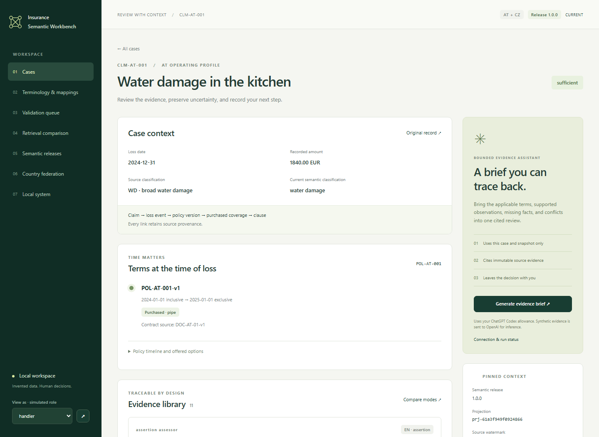
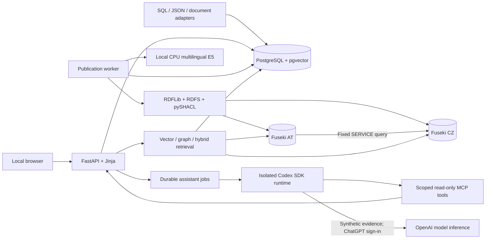
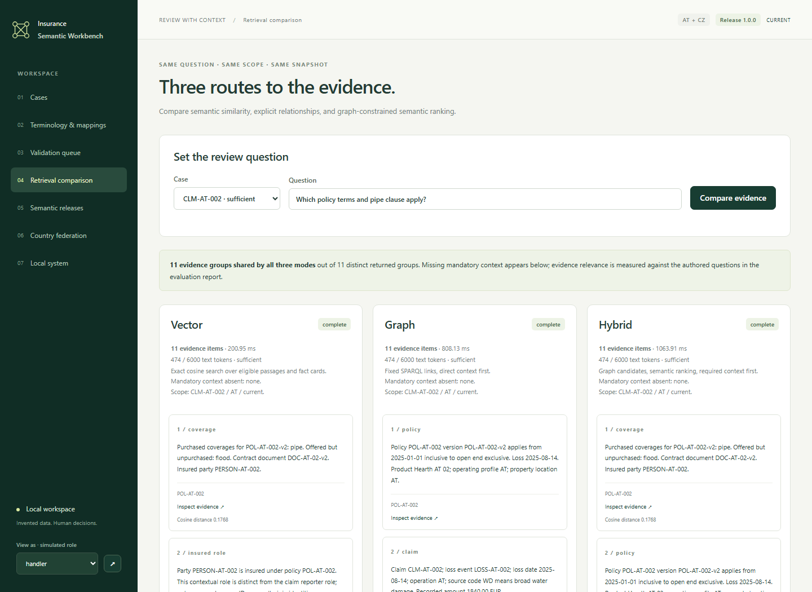

# Insurance Semantic Workbench

**Review a claim through its evidence, historical policy terms, and unresolved questions.** This local application connects invented household water-damage claims to their original records, multilingual terminology, country operating profiles, and governed semantic releases. A bounded Codex assistant can turn that context into a cited review brief; a person records the review disposition separately.



*A loss on 31 December selects the earlier policy version and its EUR 120 clause. Replacing a document later does not rewrite that evidence.*

## What you can do

- **Review a claim:** follow the policy → version → purchased coverage → clause chain; inspect exact source passages; preserve missing and contradictory assertions; generate a cited brief.
- **Steward meaning:** explore English, German, and Czech labels; distinguish a broad source code from an evidenced cause; review mapping proposals and a fictional CZ mitigation-assessment extension.
- **Release a semantic change:** build a complete candidate, inspect actual query/evidence differences, approve and activate it, then restore an earlier coherent snapshot without deleting review history.

The corpus contains **100 policies, 122 policy versions, 50 claims, and 32 document versions**. The model has **30 application classes, 55 properties, 38 baseline / 40 release-2 SKOS concepts, 20 baseline shapes, and 18 fixed competency queries**. Country rules, products, people, contracts, and records are invented; this is an independent demonstration, not an insurance decision system.

## Architecture practiced



Everything except Codex model inference runs on the local machine. Databases bind to loopback; the application uses native Python and three project-scoped Docker containers. No cloud deployment, API-key fallback, CI/CD, or JavaScript build pipeline.

| Capability | Inspect the evidence |
|---|---|
| Ontology layers, RDFS and multilingual SKOS | [Modeling standard](docs/modeling-standard.md), [semantic query results](docs/verification/semantic.json) |
| Immutable source provenance and effective-time selection | [Mapping catalog](docs/mapping-catalog.md), [fixture scenarios](fixtures/README.md) |
| Structural quarantine versus review readiness | [SHACL shapes](semantic/shapes.ttl), [browser workflows](docs/verification/workflows.json) |
| Transactional outbox, replay and interrupted cross-store publication | [Consistency decision](docs/decisions/004-publication.md), [E2E workflows](tests/e2e/test_workflows.py) |
| Independent country stores and explicit outage handling | [Federation and topology](docs/architecture.md) |
| Three retrieval modes under one scope/budget | [Measured evaluation](docs/evaluation.md) |
| Real cited briefs and enforced MCP scope | [Live verification](docs/verification.md), [protocol probe](docs/verification/mcp-scope.json) |
| Candidate impact, human approval, rollback and restore | [Demo](docs/demo.md), [operations runbook](docs/runbook.md) |

## Run locally

Tested on **Windows 11 x64**, Python **3.12**, uv, Git, and Docker Desktop using Linux containers. Docker, uv, Git, and Python must already be available. No host Java or PostgreSQL installation is needed. [Measured storage and prerequisites](docs/LOCAL_ENVIRONMENT.md) distinguish project files from shared Docker/cache allocation; allow **6–15 GiB** working storage and **30 GiB free** for downloads and temporary copies.

```powershell
git clone https://github.com/fullstack-nick/insurance-semantic-workbench.git
cd insurance-semantic-workbench
.\scripts\Setup-Lab.ps1
.\scripts\Start-Lab.ps1
.\scripts\Seed-Lab.ps1
```

Open [the first historical claim](http://127.0.0.1:8000/cases/CLM-AT-001). Setup creates local secrets, installs locked dependencies, downloads one pinned CPU embedding model, builds Fuseki, and migrates the database. Source inspection, validation, governance, retrieval, and saved-brief viewing work without Codex sign-in.

To generate new briefs, run `.\scripts\SignIn-Codex.ps1` and complete the browser flow. This uses an isolated profile at `%USERPROFILE%\.isw-codex` and your **shared ChatGPT Codex allowance**. There is no API key. Existing account credits or automatic reload may apply after included usage; the application does not buy credits or change billing settings. Synthetic evidence goes to OpenAI for inference. [Authentication and billing boundary](docs/decisions/006-codex-scope.md).

## Measured results

The [verification report](docs/verification.md) covers ten deterministic browser workflows, three opt-in live Codex workflows, one actual MCP protocol check, all 18 competency queries, and backup/restore.

The frozen evaluation ran **28 questions × 3 modes**, with **zero forbidden evidence**, and a later reproduction preserved those checks. Required-evidence coverage reached 100% across modes; most eligible case contexts fit the 12-item budget. Useful precision was only about **23–25%**, so that coverage is a corpus-size ceiling, not proof of retrieval superiority. Warm medians across the two passes ranged from **35–220 ms vector**, **186–1,020 ms graph**, and **202–1,135 ms hybrid**. Timing varied materially; these are local observations, not an isolated latency benchmark. [Conditions, both reports, and limitations](docs/evaluation.md).



## Verify and explore

```powershell
.\scripts\Verify-Lab.ps1             # real services/browser; no model requests
.\scripts\Evaluate-Lab.ps1           # frozen retrieval protocol in the test namespace
.\scripts\Verify-Lab.ps1 -LiveCodex  # explicitly consumes the signed-in Codex allowance
.\scripts\Stop-Lab.ps1               # stops this project; retains its data
```

Verification rebuilds only `isw-e2e` and `isw-e2e-restore`, backing up existing review/audit data first. Raw traces stay ignored. There are no unit tests or coverage-percentage targets. Subsequent evaluations write local reproduction reports without overwriting the published benchmark.

Follow the [five-minute demo](docs/demo.md), [architecture](docs/architecture.md), and [runbook](docs/runbook.md). Limits are deliberate: a small synthetic corpus, authored UTF-8 clauses rather than PDF/OCR ingestion, one publication worker and one assistant runner, simulated local roles, and no production multi-user authorization or automated coverage/payment decisions.

MIT © 2026 Nick Petrushin. [License](LICENSE) · [Third-party notices](THIRD_PARTY_NOTICES.md).
