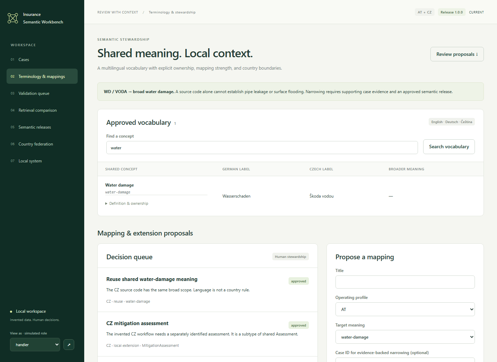
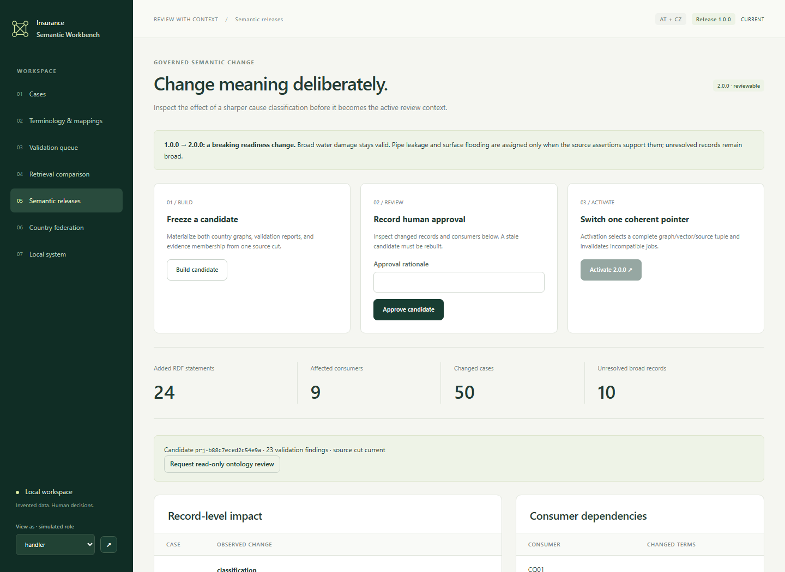

# Five-minute review path

Start and seed the interactive namespace first. The links below use its default port. Inference may take additional time and consumes the signed-in Codex allowance.

1. Open [CLM-AT-001](http://127.0.0.1:8000/cases/CLM-AT-001). Its 2024-12-31 loss selects `POL-AT-001-v1`, not the later version. Inspect the EUR 120 pipe clause and click through to its exact source span, hash and locator. Offered flood cover is not purchased.
2. Open [the conflicting claim](http://127.0.0.1:8000/cases/CLM-AT-005), then [the missing-date claim](http://127.0.0.1:8000/cases/CLM-AT-003). Both remain inspectable. One retains two incompatible assertions; the other has no guessed policy version. [Claim 010](http://127.0.0.1:8000/cases/CLM-AT-010) shows structural quarantine separately.
3. Open [CLM-CZ-002](http://127.0.0.1:8000/cases/CLM-CZ-002). Its German document still uses the CZ operating profile and mitigation assessment. In [terminology](http://127.0.0.1:8000/terminology), inspect multilingual labels and the reuse/local-extension/rejected-globalization proposals. Similar names are not identity evidence.
4. Generate a brief for the historical claim, inspect a citation, and record a review note through **Record human decision**. The generated next step and the explicit disposition have different records. A later source correction keeps the old brief and starts a fresh thread for new context.
5. Open [releases](http://127.0.0.1:8000/releases). Build 2.0.0; inspect changed records, evidence groups, CQ16 bindings and declared consumers. Supported causes narrow; broad/contradictory examples remain unresolved. Record an approval rationale, activate, and restore a retained 1.0.0 projection. Revisit the earlier brief.
6. Compare the same scope in [three retrieval modes](http://127.0.0.1:8000/compare). Read the [evaluation](evaluation.md) before interpreting ranking distances as usefulness.

For the service-failure and restore portions, use `Verify-Lab.ps1`: E10 stops only the test CZ endpoint and checks strict failure, labeled partial results and recovery; E09 backs up and restores a saved review into a separate fresh namespace. The [runbook](runbook.md) documents the interactive restore drill and scoped cleanup.

All records and roles in this story are simulated. Reviewing evidence does not establish coverage, liability or a payment decision.
